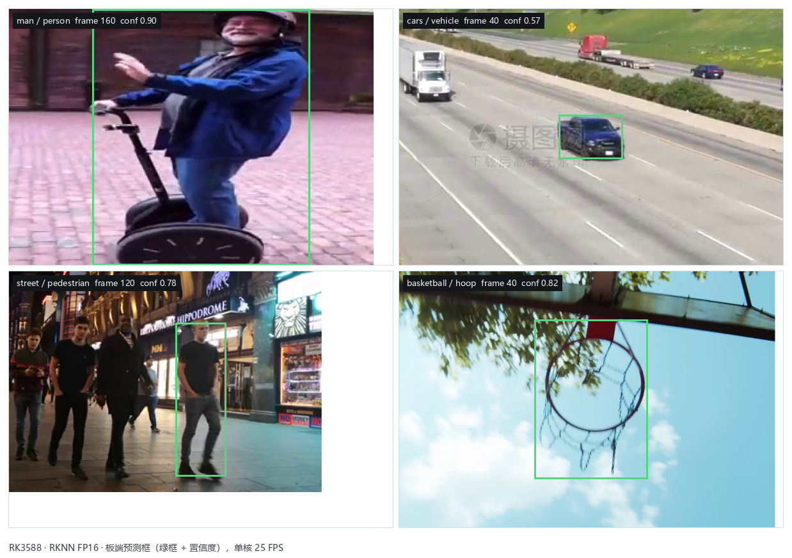
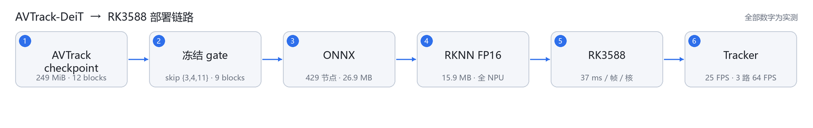
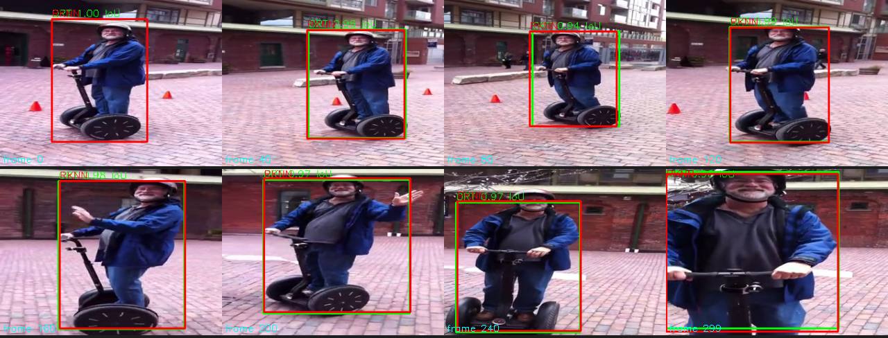
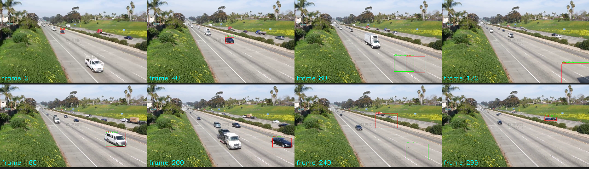
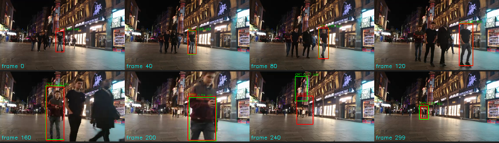

<div align="center">

# AVTrack · RK3588

**ICML'24 的 UAV 跟踪器（DeiT-Tiny + 320-token joint attention）完整跑在 RK3588 NPU 上。**
FP16 · 单核 25 FPS · 三路 64 FPS · 与 FP32 逐帧一致到亚像素

[](#已验证环境)
[](#实测)
[](#实测)
[](#实测)
[](LICENSE)



</div>

板端 RKNN 的预测框（绿框 + 置信度），四段演示视频。三路并行时每路 44–50 ms/帧。



## 实测

| | |
|---|---|
| 模型 | `avtrack_gate9_op17_fp16.rknn` · **15.89 MB** · 187 层全上 NPU（零 CPU 回退） |
| 延迟 | **39.9 ms/帧 ≈ 25.1 FPS**（单核，其中 NPU 37.1 ms；预处理 2.7 ms，后处理 0.09 ms） |
| 吞吐 | 3 进程各绑一核 → **63.9 FPS 合计**（RK3588 只有 3 个 NPU core） |
| 精度 | 同像素逐帧 vs FP32：**IoU 0.9975 / 0.9978 / 0.9971 / 0.9805**，中心误差 **0.09–0.54 px**，argmax 20/20 同格 |
| 长稳 | 连续 8000 帧：NPU p50 37.3 ms、38.8→41.6 °C、内存 +5 MB，不降频不泄漏 |
| 上限 | RK3588 非量化最高精度就是 **FP16**（`float_dtype` 只接受 `float16`），没有 FP32 可退 |

<details>
<summary><b>精度细节（点击展开）</b></summary>

| 视频 | 帧数 | IoU 均值 / p05 | 中心误差 均值 / max | argmax 相同 |
|---|---|---|---|---|
| man | 300 | **0.9975** / 0.9951 | 0.148 / 0.98 px | 300/300 |
| cars | 300 | **0.9978** / 0.9933 | 0.086 / 1.14 px | 299/300 |
| basketball | 88 | **0.9971** / 0.9944 | 0.542 / 1.96 px | 88/88 |
| street | 300 | 0.9805 / 0.9869 | 1.170 / 100.91 px | 292/300 |

板端 map 误差（20 组同像素）：`score 9.98e-3 / size 6.29e-3 / offset 5.35e-2`；
解码后 `dx 0.63 px`、`w 1.90 px`、`conf 1.0e-2`。street 的 8/300 帧是 argmax 翻转帧（峰值接近平局）。

</details>

## 为什么这个仓库值得看

AVTrack 的 `forward_features` 里有一个**数据相关的跳块开关**（`prob_active > 0.5` 才执行整个 block）。
`torch.onnx.export` 只能记录一条 trace 路径，于是"哪几个 block 被执行"被**固化成常量**：

| 同一份 checkpoint，两次导出 | 冻结的 block | 跟踪差异 |
|---|---|---|
| 早期导出（PyTorch 2.0, opset 11） | `0,1,2,`**`5`**`,6,7,8,9,10` | 逐帧 IoU **0.913**，82/299 帧 <0.9，框宽最大差 **32 px** |
| 另一版导出（PyTorch 2.3, opset 17） | `0,1,2,`**`4`**`,6,7,8,9,10` | 两张图"看起来都正常" |

而 checkpoint 里有 12 个 block：block 11 事实上被训练关死（概率 <1e-6），block 2/3 的 gate 是 0.5001/0.4998 的准常数，
block 4/5 随帧翻转。**部署侧必须自己钉一张确定性的表** —— 本仓库钉 `{跳 3,4,11}`（= 训练的期望路径，平均 9 块），
用 20 行 `freeze_gate()` 实现，不改上游、不动参数，导出后还断言 block 集合 + 双 dummy 输出差必须为 0.0。

细节与 26 条踩坑记录：[docs/PIPELINE.md](docs/PIPELINE.md)

## 快速开始

```bash
# A) 只要模型：从 Release 下载（md5 见 Release 说明；RKNN 会写构建信息，重跑 md5 会变）
gh release download v1.0 -p '*.rknn' -p '*.onnx'

# B) 完整复现
git clone https://github.com/wuyou3474/AVTrack ../AVTrack     # 上游代码 + 自备 checkpoint/视频
export PY=/path/to/python SRC=../AVTrack VIDEOS=../videos

bash scripts/01_export_onnx.sh      # gate9 ONNX（op17 429 节点 / op11 后备）
bash scripts/02_make_reference.sh   # 20 组同像素基准 + 冻结语义参考
bash scripts/03_build_rknn.sh       # ONNX → RKNN FP16（同会话 simulator 校验）

export BOARD=user@<board-ip> SSHPASS='****'    # 密码只走环境变量
bash scripts/04_deploy.sh && bash scripts/05_board_numeric.sh && bash scripts/06_board_bench.sh
bash scripts/07_track_pc.sh && bash scripts/08_track_board.sh && bash scripts/09_fair_l1.sh
```

<details>
<summary><b>PC（FP32）与板端（FP16）同帧对比（3 段视频）</b></summary>

| man | cars |
|---|---|
|  |  |



绿框 = PC ORT（FP32），红框 = 板端 RKNN（FP16）。两边都在目标上，尺寸估计有差异 ——
这是**视频解码差 ±2 灰度级**被跟踪闭环放大的结果，不是 NPU 算错：
同像素基准下逐帧 IoU 是 0.997+，而给输入加 ±2 噪声就能把逐帧 IoU 打到 0.60–0.86。
参见 [docs/PIPELINE.md](docs/PIPELINE.md) 与 [results/tracking.md](results/tracking.md)。

</details>

## 已验证环境

`rknn-toolkit2 2.5.0` · `librknnrt 2.5.0` · `rknn-toolkit-lite2 2.5.0` · PC: torch 2.4.0 + onnx 1.18.0 + onnxruntime 1.23.2（Python 3.10） · 板端: Python 3.8 + numpy 1.24 + opencv 4.12

## 文档

| | |
|---|---|
| [docs/DEPLOY.md](docs/DEPLOY.md) | 部署手册：判据、失败处理、DoD 清单 |
| [docs/PIPELINE.md](docs/PIPELINE.md) | 全链路复盘：pt→onnx→rknn→板端→闭环，26 条坑 |
| [docs/REPRODUCE.md](docs/REPRODUCE.md) | 从零复现的最小步骤 + 预期数字 |
| [results/ACCEPTANCE.md](results/ACCEPTANCE.md) | 验收结论（DoD 逐条） |
| [results/](results) | 精度 / 延迟 / 跟踪报告与原始 JSON |

## 引用

```bibtex
@inproceedings{li2024avtrack,
  title={Learning Adaptive and View-Invariant Vision Transformer for Real-Time UAV Tracking},
  author={Li, Yongxin and Liu, Mengyuan and Wu, You and Wang, Xucheng and Yang, Xiangyang and Li, Shuiwang},
  booktitle={ICML}, year={2024}}
@article{wu2025avtrack,
  title={Learning an Adaptive and View-Invariant Vision Transformer for Real-Time UAV Tracking},
  author={Wu, You and Li, Yongxin and Liu, Mengyuan and Wang, Xucheng and Yang, Xiangyang and Ye, Hengzhou and Zeng, Dan and Zhao, Qijun and Li, Shuiwang},
  journal={IEEE TCSVT}, year={2025}}
```

模型与训练代码来自 [wuyou3474/AVTrack](https://github.com/wuyou3474/AVTrack)（MIT），构建于
[OSTrack](https://github.com/botaoye/OSTrack) / [PyTracking](https://github.com/visionml/pytracking) /
[timm](https://github.com/huggingface/pytorch-image-models)；DeiT 权重来自 [facebookresearch/deit](https://github.com/facebookresearch/deit)（Apache-2.0）。
Release 权重由 AVTrack checkpoint 转换而来（训练用 LaSOT/GOT10K/COCO/TrackingNet），**仅供研究使用**。

## License

[MIT](LICENSE) — 上游 © 2024 You Wu；本仓库脚本/文档/结果 © 2026 contributors。
